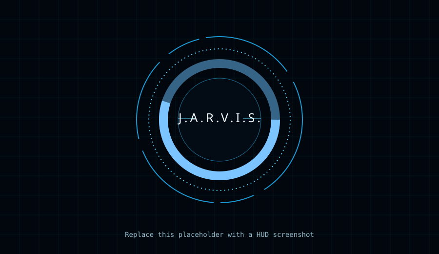
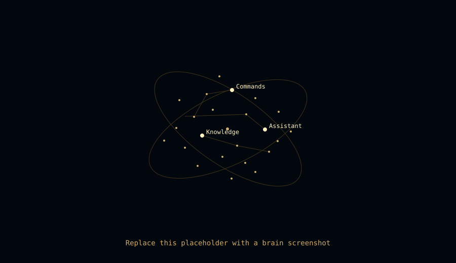

# J.A.R.V.I.S.

A local Python assistant with a cyan sci-fi HUD and an optional golden knowledge brain. The HUD is always the default on page load; the brain view opens only when requested. The browser UI is one self-contained HTML file, and the Python standard library provides the local server and assistant APIs.





## Features

- OpenAI Responses API chat with a concise JARVIS persona and the latest ten conversation turns held in server memory.
- Server-side Fish Audio text-to-speech (TTS), with browser speech synthesis as a fallback. API credentials stay on the local server.
- Local notes and a searchable knowledge folder containing Markdown, text, and PDF documents. Documents are chunked with overlap, indexed in a local JSON file, and only re-extracted when their SHA-256 hash changes.
- BM25-style local retrieval. The best matching excerpts are shown with their source names; with **Share knowledge with AI** disabled, document text is never sent to an AI service. If enabled, retrieved excerpts are sent to OpenAI as context.
- Golden brain nodes and links for repository features, notes, and indexed documents. Click a knowledge node to read its summary; **Open file** asks for confirmation first.
- Three auto-loaded skills: weather placeholder, local timer/reminder, and unit conversion. Invalid skill files are skipped with a warning.
- Settings for sound, spoken replies, speech speed, reduced motion, particle density, accent intensity, knowledge folder, and document sharing. Settings are stored locally in `jarvis_config.json`; this file is ignored by Git.
- Optional Web Audio sound effects, browser voice input, a Jarvis wake-word filter, low-motion support, tab-hidden animation pause, and reduced particle density when rendering slows.

## Setup

1. Use Python 3.10 or newer. Copy `.env.example` to `.env` and add your keys:

   ```sh
   cp .env.example .env
   ```

   Set `OPENAI_API_KEY` for AI chat. Set `FISH_API_KEY` to enable Fish Audio TTS. Optional variables are `OPENAI_MODEL`, `FISH_MODEL`, `FISH_VOICE_ID`, and `KNOWLEDGE_DIR`. The local server reads `.env` without overriding environment variables already set by your shell.

2. Start the server:

   ```sh
   python3 jarvis_ui/server.py
   ```

3. Open <http://127.0.0.1:8765/>. Use `JARVIS_PORT=8766 python3 jarvis_ui/server.py` to select another port.

Python dependencies: **none**. PDF text extraction uses `pdftotext` from Poppler; install it if you want PDF indexing. Markdown and text indexing work without it. No `.env`, API keys, notes, settings, or knowledge index belong in Git; `.env`, `notes.json*`, `knowledge_index.json`, and `jarvis_config.json` are ignored.

### Voice requirements

Voice input uses the browser Web Speech API and needs a supported browser plus microphone permission. `localhost` and `127.0.0.1` count as secure contexts. Voice input may not be available in every browser. Spoken replies use Fish Audio when `FISH_API_KEY` is configured and the **Voice** setting is on; if the service is unavailable, the UI tries browser speech synthesis. The voice setting is off by default. Fish Audio receives the reply text for speech generation; knowledge document excerpts are not sent to Fish Audio.

### GitHub Pages

GitHub Pages can serve the static HTML, but it cannot run the Python assistant. The UI sends `/api/...` requests to the same origin, so a Pages deployment also needs a separately hosted backend behind a compatible reverse proxy or an explicit UI API-base configuration. The included server binds to loopback for local use; do not expose API keys in static JavaScript.

## Knowledge folder

Put `.md`, `.txt`, or `.pdf` files in `knowledge/`, or choose a different local path in the settings panel (or set `KNOWLEDGE_DIR`). The server indexes the folder at startup and after a folder change. Use **INDEX NOW** or `index knowledge` to rescan. Files are processed locally; there is no upload unless **Share knowledge with AI** is deliberately enabled. The JSON index is local and ignored by Git. `forget <file>` removes a matching item from that index but leaves the source file on disk. `what's new in your brain` reports files indexed or changed within the last seven days.

## Commands

### Modes and local utilities

- `show brain`, `open the brain`, `show your knowledge brain`, or `brain` — open the golden brain. It is never shown on page load.
- `hide brain`, `back`, or `interface` — return to the cyan HUD.
- `time`, `what time is it`, `date`, or `what is the date` — local clock response.
- `system status` — report available CPU load, memory, and battery readings.
- `index knowledge` — rescan the configured knowledge folder.
- `remember that ...` / `forget ...` — add or remove a personal note; forget can also remove a matching document from the local index.

### Knowledge and skills

- `what do you know about <topic>` — search local indexed files, notes, and repository features. A document answer includes its source filename; the matching brain nodes are highlighted.
- `what's new in your brain` — list recent indexed files.
- `list your skills` — list active skills.
- `weather in <place>` / `forecast ...` — explains that the included weather provider is a placeholder; it makes no network request.
- `set timer for 5 minutes` / `timer 30 seconds` / `remind me in 1 hour` — local browser timer.
- `convert 5 km to miles` — convert common length or mass units, or Celsius/Fahrenheit.

### Web and confirmation

- `open website example.com` or `open https://example.com` — asks **Shall I proceed, sir?** before opening a tab.
- `web search for <query>` — asks before opening a search results tab.
- `yes` / **YES** confirms a pending action; `no` / **NO** cancels it. The web UI does not launch local apps or shell commands.

Any other text is sent to the configured AI backend. Empty and overlong inputs are rejected locally with an in-character response.

## Add a skill

Create one Python file in `skills/`. The server loads every non-underscore `.py` file at startup. A skill exports a display `name`, a non-empty list of regex strings in `trigger_phrases`, a `handler(text)` function returning a reply, and optionally a `capabilities` list. Allowed capabilities are `files`, `programs`, and `network`; any non-empty list causes J.A.R.V.I.S. to ask for confirmation before calling the handler. Never build shell commands from AI output.

```python
import re

name = "Example"
trigger_phrases = [r"\bexample phrase\b"]
capabilities = []  # use files/programs/network when applicable

def handler(text):
    match = re.search(r"example phrase\s+(.+)", text, re.I)
    return f"I found {match.group(1)}, sir." if match else "Please clarify, sir."
```

Broken or malformed skills are skipped with a warning, and other skills continue loading.

## Keyboard shortcuts

- **Enter** — send the command.
- **Esc** — close settings or return to the HUD.
- **B** — toggle brain, unless the command input is focused.
- Click or press a key during startup to skip the boot sequence.

## Tests

Run the standard-library test suite:

```sh
python3 -m unittest discover -s tests -v
```

## Troubleshooting

- **AI is offline:** check `OPENAI_API_KEY`, internet access, and the configured model in `.env`; restart the local server after environment changes.
- **Fish Audio voice unavailable:** check `FISH_API_KEY`, model/voice settings, internet access, and the browser console/network response. Browser speech synthesis is used as a fallback when supported.
- **No microphone input:** allow microphone access and use a browser with Web Speech API support. Voice input is an optional browser feature.
- **PDF is missing from the index:** install Poppler's `pdftotext`, then choose **INDEX NOW**.
- **Knowledge results are stale:** run `index knowledge`, check the configured folder path, and verify that the file is `.md`, `.txt`, or `.pdf`.
- **Settings or index files are not visible in Git:** this is expected; local configuration and private knowledge files are ignored.
